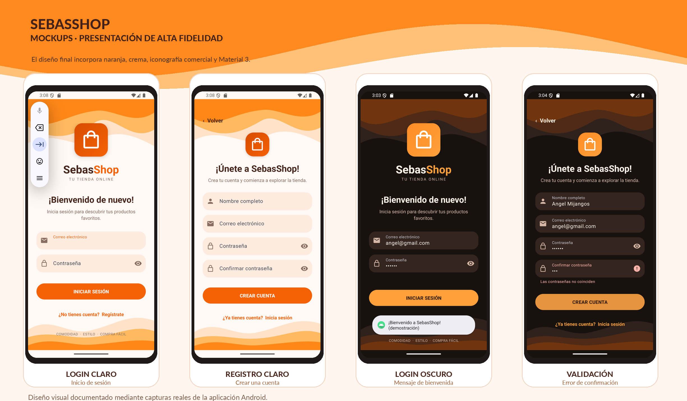
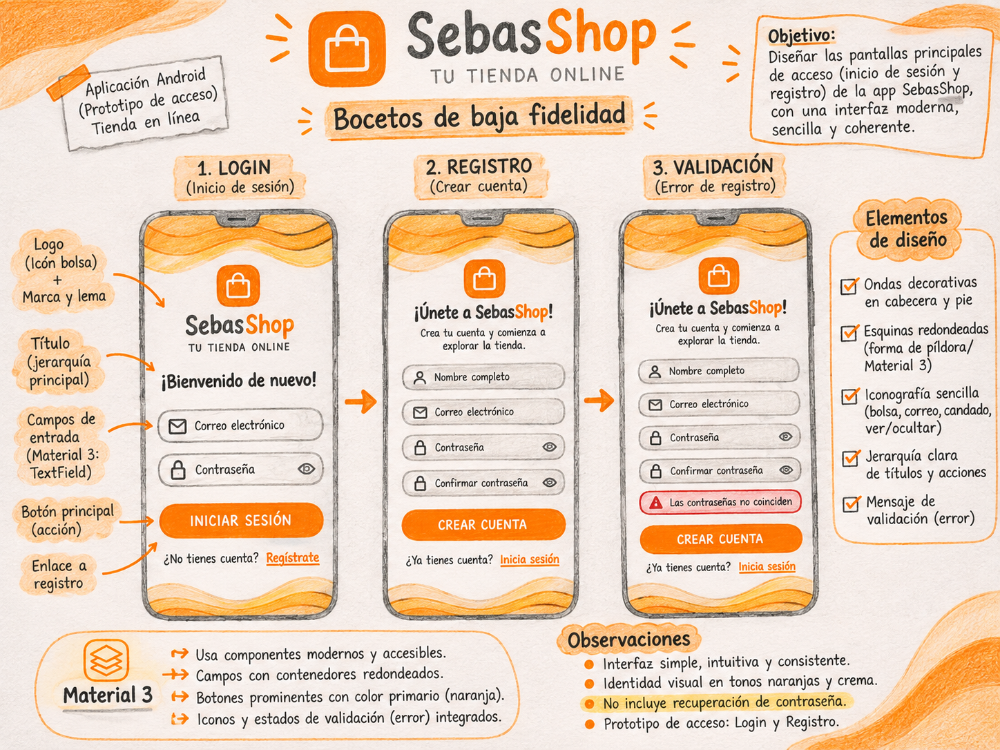
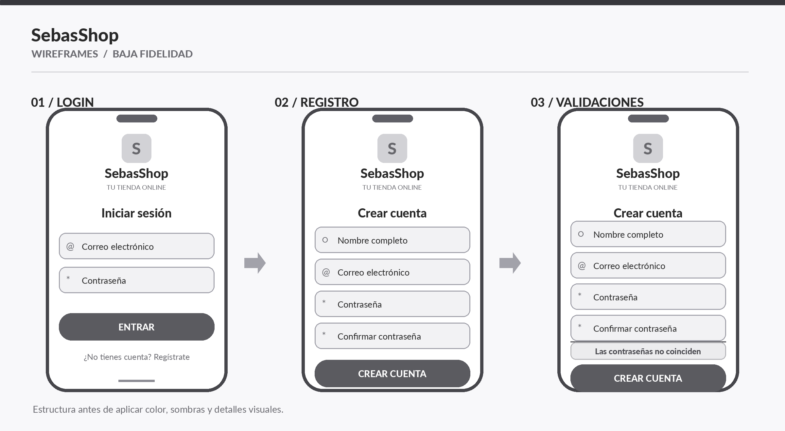
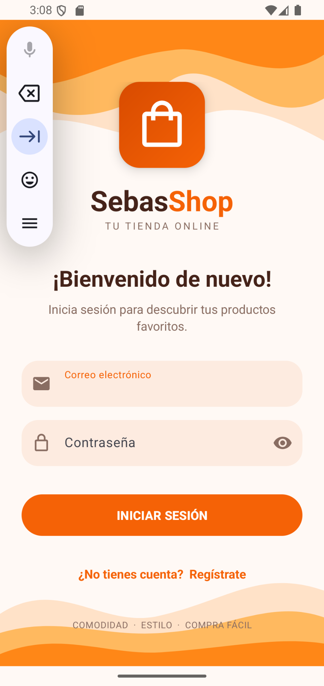
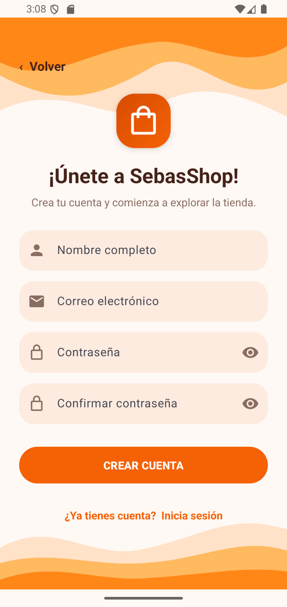
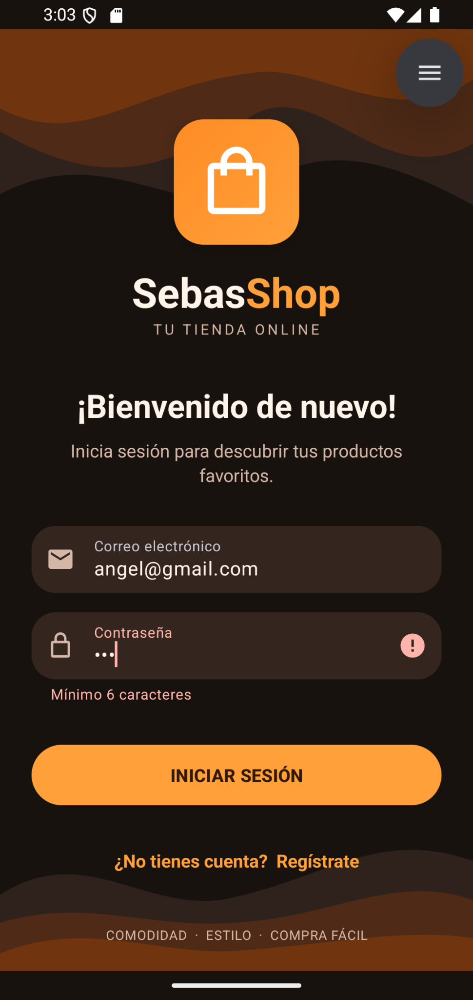
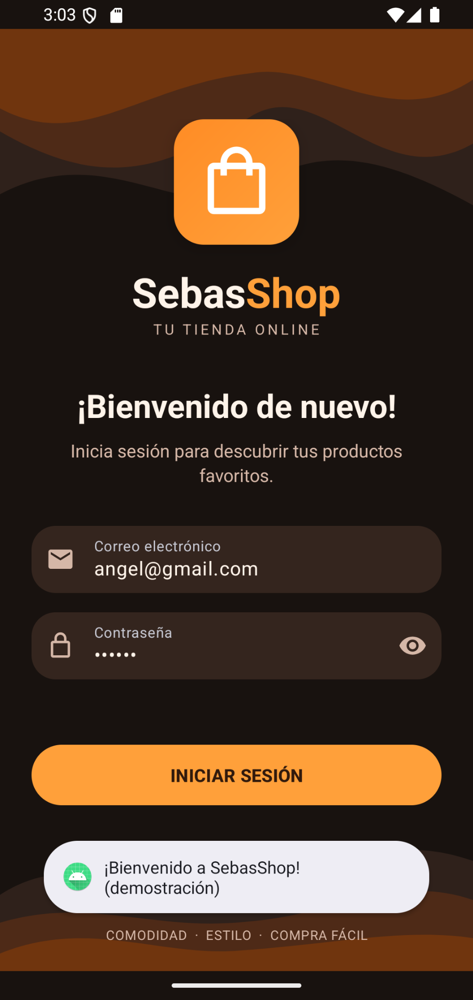
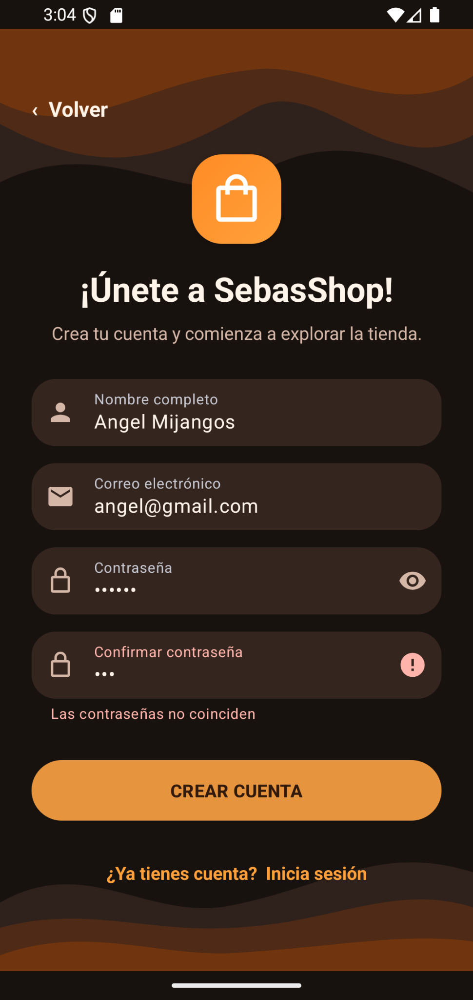
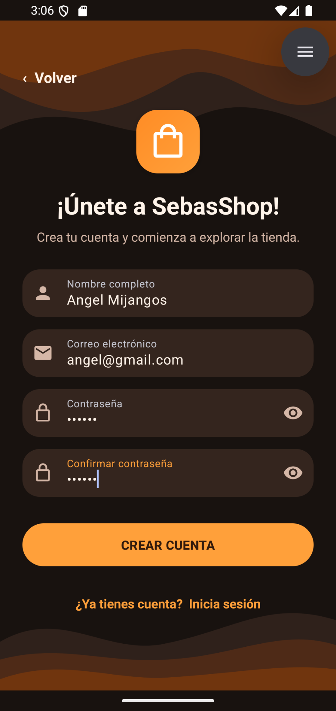

# 🛍️ SebasShop

**Prototipo de inicio de sesión y registro para una aplicación móvil de tienda en línea.** Proyecto realizado con **Java, XML, Android Studio y Material Design 3**, con apariencia naranja y crema y adaptación a tema oscuro.

> **Importante:** SebasShop es un prototipo académico de interfaces. El registro e inicio de sesión están **simulados**: no existe backend, base de datos de usuarios, catálogo real, pagos ni procesamiento de compras.



## Contenido

- [Objetivo](#objetivo)
- [Funcionalidades](#funcionalidades)
- [Proceso de diseño](#proceso-de-diseño)
- [Capturas de la aplicación](#capturas-de-la-aplicación)
- [Tecnologías](#tecnologías)
- [Estructura del proyecto](#estructura-del-proyecto)
- [Instalación y ejecución](#instalación-y-ejecución)
- [Pruebas](#pruebas)
- [Alcance y autoría](#alcance-y-autoría)

## Objetivo

Diseñar y desarrollar una interfaz móvil moderna para el acceso de usuarios a una tienda en línea, priorizando la claridad visual, la navegación intuitiva, los estados de error comprensibles y una identidad gráfica consistente en modos claro y oscuro.

## Funcionalidades

- **Inicio de sesión:** campos para correo y contraseña; validación de campos vacíos, formato de email y contraseñas de al menos 6 caracteres.
- **Registro:** nombre completo, correo, contraseña y confirmación; validación de contraseña coincidente y mensajes de error.
- **Navegación:** acceso del login al registro y regreso a la pantalla de inicio.
- **Visibilidad de contraseña:** ícono para mostrar u ocultar los caracteres.
- **Confirmación simulada:** mensajes tipo `Toast` al completar los formularios válidamente.
- **Material 3:** elementos visuales modernos, bordes redondeados, controles de texto y temas claro y oscuro.
- **Identidad de tienda:** logo de bolsa de compras, ondas decorativas y paleta naranja/crema.

**No incluye recuperación de contraseña**, por decisión de alcance. Tampoco existe una tercera `Activity` de validación: los errores aparecen dentro de las pantallas de login y registro.

## Proceso de diseño

### 1. Bocetos

Exploración inicial de la jerarquía visual y distribución de campos, botones, encabezados y mensajes.



### 2. Wireframes

Estructura en escala de grises para inicio de sesión, registro y estado de validación, antes de aplicar el acabado visual.



### 3. Mockups

Presentación visual de alta fidelidad, basada en las capturas reales de la app, con el esquema naranja/crema y su variante oscura.


## Capturas de la aplicación

### Login en modo claro



### Registro en modo claro



### Validación de contraseña corta



### Bienvenida simulada en modo oscuro



### Contraseñas que no coinciden



### Registro en modo oscuro



## Tecnologías

| Componente | Tecnología |
|---|---|
| IDE | Android Studio |
| Lógica de interfaz | Java |
| Diseño de pantallas | XML |
| Componentes visuales | Material Design 3 / Material Components |
| Temas | Recursos `values` y `values-night`, con compatibilidad para colores dinámicos cuando estén disponibles |
| Compilación | Gradle (Kotlin DSL) |

## Estructura del proyecto

```text
SebasShop/
├── app/
│   └── src/main/
│       ├── AndroidManifest.xml
│       ├── java/com/cg128/sebasshop/
│       │   ├── MainActivity.java
│       │   └── ui/
│       │       ├── LoginActivity.java
│       │       └── RegistroActivity.java
│       └── res/
│           ├── layout/activity_login.xml
│           ├── layout/activity_registro.xml
│           ├── drawable/
│           ├── values/
│           └── values-night/
├── docs/imagenes/
├── build.gradle.kts
└── settings.gradle.kts
```

## Instalación y ejecución

1. Clonar este repositorio o descargarlo como ZIP.
2. Abrir la carpeta raíz `SebasShop` con **Android Studio**.
3. Esperar la sincronización de Gradle y la descarga de dependencias.
4. Seleccionar un emulador o dispositivo Android compatible con el `minSdk` del proyecto.
5. Ejecutar el módulo **app** y comprobar la navegación del login al registro.
6. Cambiar el dispositivo al modo oscuro para observar la variante nocturna.

## Pruebas

| Caso | Resultado esperado |
|---|---|
| Correo vacío | Mensaje de campo obligatorio |
| Correo mal formado | Mensaje de formato inválido |
| Contraseña con menos de 6 caracteres | Error de longitud |
| Campos correctos en login | Mensaje de bienvenida de demostración |
| Contraseñas distintas en registro | Error de confirmación |
| Registro con campos válidos | Mensaje de creación simulada |
| Cambio de modo claro a oscuro | Ajuste de recursos y colores de la interfaz |

Las capturas adjuntas evidencian manualmente estos estados; no representan pruebas automatizadas ni validación de credenciales contra un servidor.

## Alcance y autoría

- **Aplicación:** SebasShop
- **Tipo:** prototipo académico de interfaz de tienda
- **Materia:** Diseño y Desarrollo de Interfaces Móviles
- **Alumno:** ANGEL SEBASTIAN BALTAZAR MIJANGOS
- **Institución:** Tecnológico de Estudios Superiores del Oriente del Estado de México
- **Fecha de documentación:** noviembre de 2026

> Antes de publicar, verifica que los nombres y correos de ejemplo visibles en las capturas puedan difundirse en un repositorio público.
